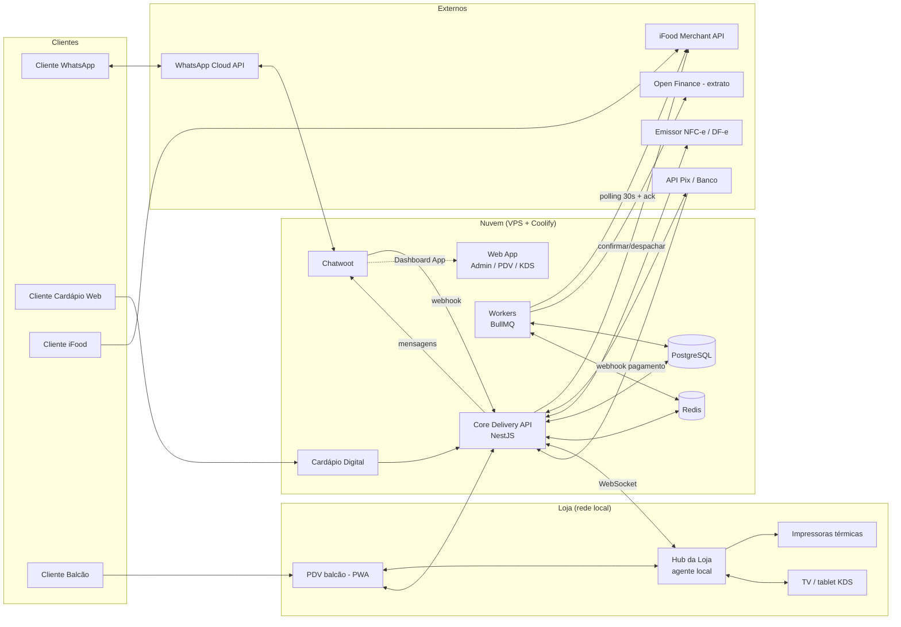
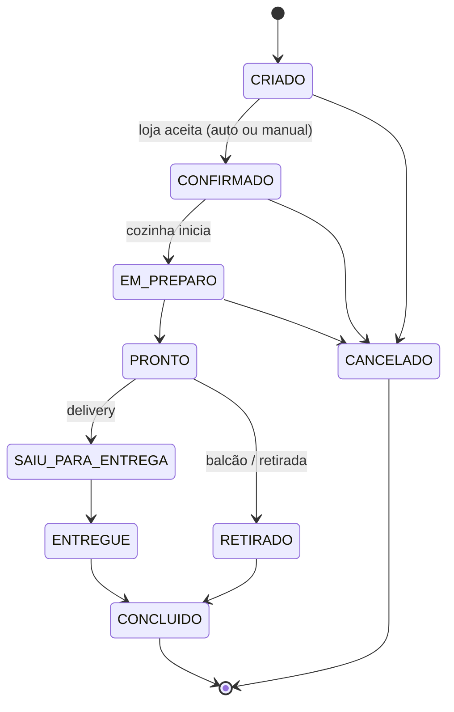
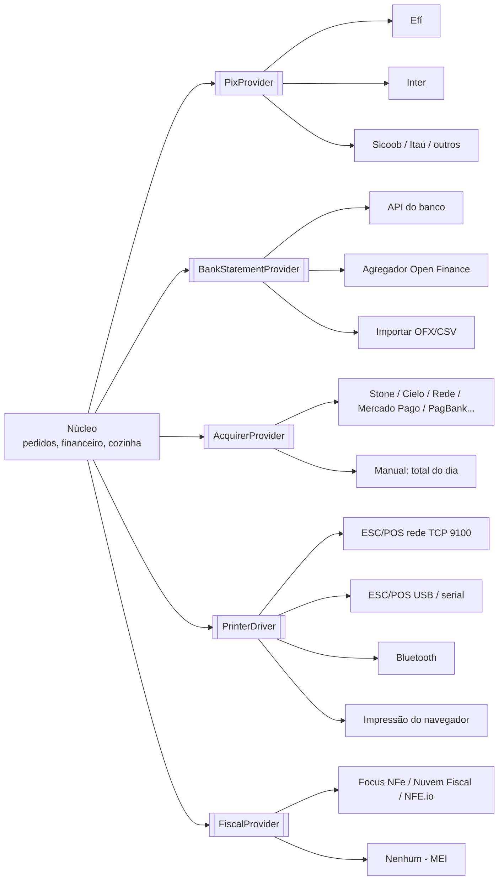
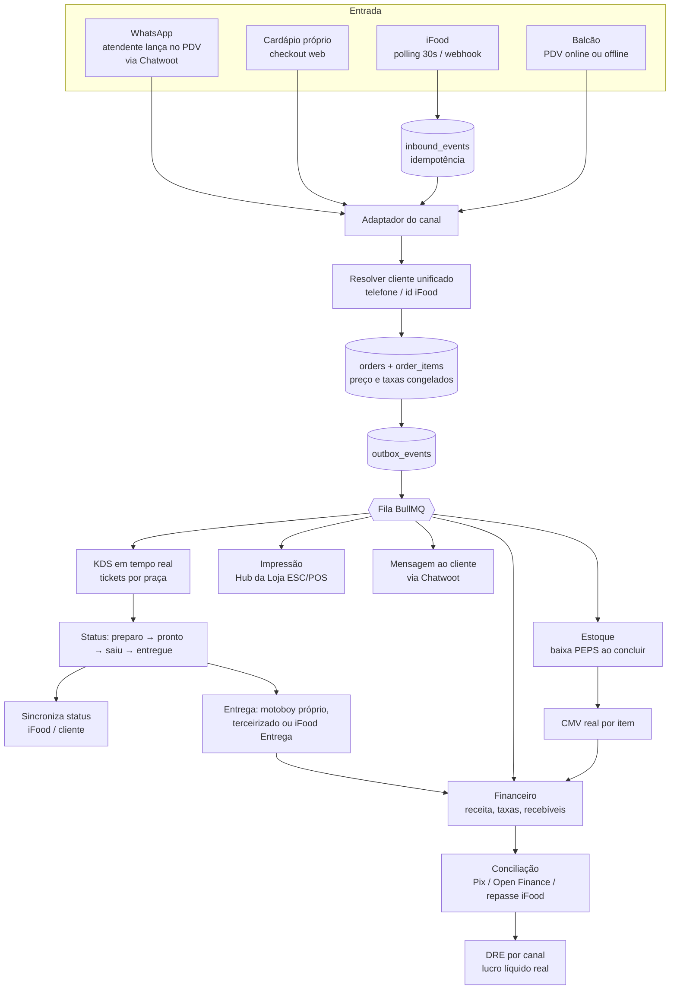
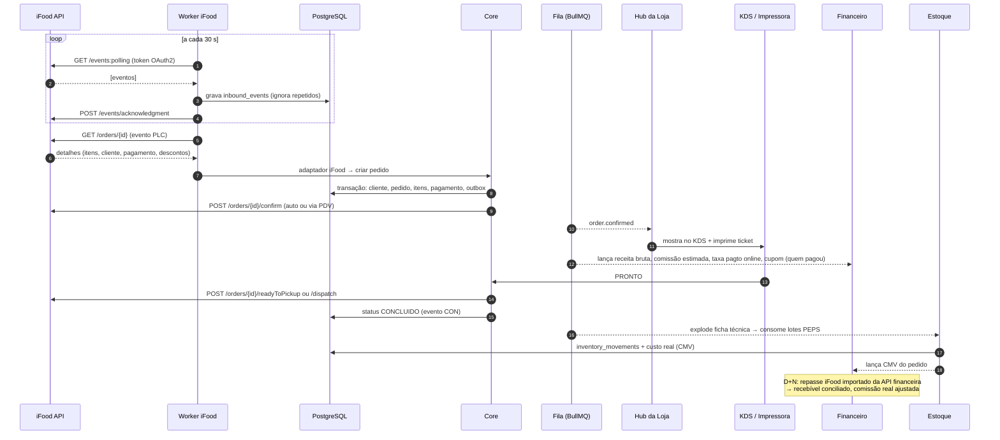
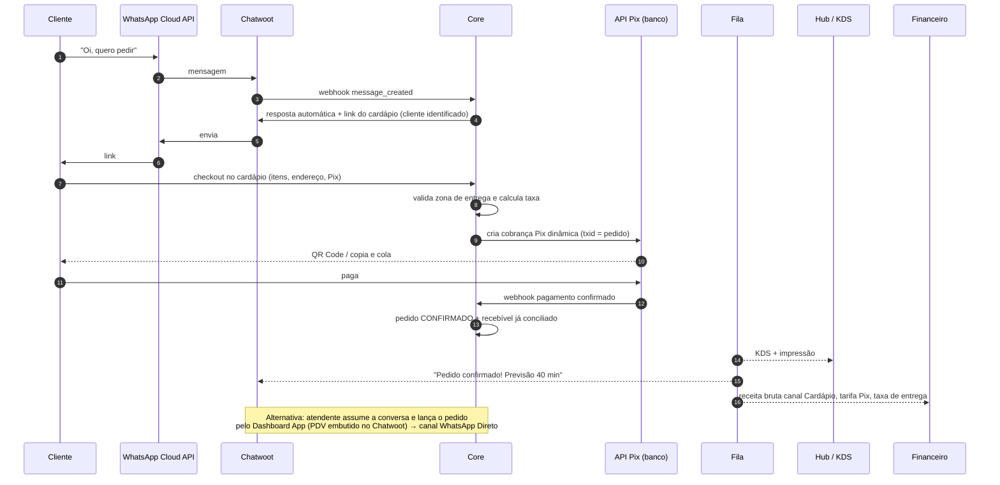
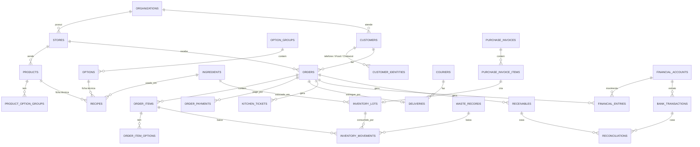

# Seu Alves — Plano Arquitetural do Sistema Unificado de Delivery

> Versão 0.6 · 27/11/2026 · Documento de desenho (ainda sem código de aplicação)

Este documento une os quatro pilares (WhatsApp/atendimento, cardápio + PDV + KDS, iFood e financeiro) em um único sistema próprio, já considerando as respostas do questionário inicial. Onde algo ainda depende de uma informação sua, está marcado com **⚠ A confirmar**.

---

## 0. Resumo das decisões

| Tema | Decisão | Por quê |
|---|---|---|
| Linguagem | **TypeScript em tudo** (backend, workers, telas) | Você desenvolve sozinho com IA: uma linguagem só, um tipo de erro, código compartilhado entre API e telas. É a linguagem em que as IAs geram código mais confiável. |
| Formato do backend | **Monólito modular** + 1 processo de workers | Microsserviços dariam trabalho de operação sem ganho no seu volume. Os módulos ficam separados por pastas e contratos, então dá para extrair um serviço no futuro se precisar. |
| Banco | **PostgreSQL** | Transações fortes (estoque PEPS e financeiro não podem ficar "meio gravados"), JSON para guardar payloads do iFood, gratuito. |
| Filas | **Redis + BullMQ** | Agenda o polling do iFood a cada 30 s, faz retentativas automáticas e evita processar o mesmo evento duas vezes. |
| WhatsApp | **Chatwoot + WhatsApp Cloud API (oficial)**, **sem Evolution API** | O Chatwoot já conecta direto na API Oficial da Meta. O Evolution API só faz sentido para números não oficiais (Baileys). Uma peça a menos para manter. |
| Typebot / n8n | **Opcionais, fora do MVP** | O fluxo inicial (boas-vindas, link do cardápio, status do pedido) é simples e fica melhor no nosso código. n8n pode entrar depois para automações periféricas, nunca no caminho crítico do pedido. |
| Firefly III / ERPNext | **Não rodar; usar como referência de modelagem** | São sistemas grandes e genéricos. O seu financeiro precisa nascer ligado ao pedido, ao estoque PEPS e às taxas por canal, o que é mais simples de construir no núcleo. |
| Banco, maquininha, impressora, fiscal | **Adaptadores genéricos** (seção 1.9) | Nada fica amarrado a um fornecedor; vários modelos convivem e cada loja escolhe os seus. |
| NFC-e | **Fora do MVP** (empresa é MEI), módulo previsto para ligar depois | MEI é dispensado em vendas ao consumidor final (seção 5). |
| Visual | **Identidade do Seu Alves em todas as telas**, design system único, dashboards com gráficos (seção 2.6) | Tudo com a mesma cara do cardápio, limpo e fácil de ler no celular, tablet ou TV. |
| Hospedagem | **1 VPS (8 GB RAM) com Coolify**, backups automáticos externos | Roda 24/7 sem você online, custo estimado de R$ 100 a R$ 200/mês com tudo. Detalhes na seção 2.5. |
| Offline | **PWA no balcão/KDS + "Hub da Loja"** (mini PC na loja) | Se a internet cair, balcão, impressão e KDS continuam e sincronizam depois. |
| Multi-loja | Toda tabela tem `store_id` desde o dia 1 | Abrir a segunda loja vira cadastro, não reescrita. |

---

## 1. Arquitetura recomendada

### 1.1 O que é pronto (self-hosted) e o que é nosso

| Componente | Tipo | Papel |
|---|---|---|
| **Chatwoot** | Pronto (Docker) | Caixa de entrada multi-atendente do WhatsApp, histórico, etiquetas, transbordo humano. Embute a nossa tela de "lançar pedido" via *Dashboard App* (iframe dentro da conversa). |
| **WhatsApp Cloud API** | Serviço da Meta | Número oficial. Conectado ao Chatwoot. |
| **Core Delivery (API)** | **Nosso** | Catálogo, clientes unificados, pedidos de todos os canais, máquina de estados, KDS em tempo real, impressão, entregas, estoque, financeiro. |
| **Workers** | **Nosso** | Polling iFood (30 s), acknowledgment, sincronização de status, envio de mensagens, conciliação bancária, importação de NF, cálculo de CMV. |
| **Web App (Admin + PDV + KDS)** | **Nosso** (PWA) | Telas internas. Funciona offline no balcão e na cozinha. |
| **Cardápio Digital** | **Nosso** | Evolução do `index.html` atual: carrinho, checkout, Pix online, pedido entra direto no sistema (sem depender do `wa.me`). |
| **Hub da Loja (agente local)** | **Nosso** | Programa leve num mini PC na loja: ponte de impressão térmica (ESC/POS), retransmissor local do KDS e fila offline. |
| **Emissor fiscal** (Focus NFe, Nuvem Fiscal, NFE.io ou PlugNotas) | API terceirizada | NFC-e (se obrigatória) e download de XML de NF de compra pela chave. Não vale construir integração direta com a SEFAZ. |
| **API Pix / Open Finance** (Efí, Inter, Sicoob… / Pluggy) | API terceirizada | Pix com QR dinâmico por pedido + leitura de extrato para conciliação. |
| Typebot, n8n | Pronto (opcional, fase futura) | Fluxos de marketing, automações paralelas. |

### 1.2 Como os módulos conversam

Três formas de comunicação, cada uma com um uso claro:

1. **REST síncrono** (HTTP/JSON): telas → Core; Core → APIs externas (iFood, Chatwoot, Pix, emissor fiscal).
2. **Webhooks de entrada**: Chatwoot, provedor Pix, emissor fiscal e (opcionalmente) iFood chamam `POST /webhooks/<origem>`. Regra de ouro: **gravar o payload cru na tabela `inbound_events`, responder 200 em milissegundos e processar depois na fila.** Assim nada se perde se algo falhar no processamento, e eventos repetidos são ignorados pela chave de idempotência.
3. **Filas + eventos internos** (BullMQ): quando o Core grava um pedido, grava na mesma transação um registro em `outbox_events` (padrão *Transactional Outbox*). Um despachante publica esses eventos na fila e cada consumidor reage: KDS (WebSocket), impressão, financeiro, mensagem ao cliente, baixa de estoque. Se um consumidor falhar, ele tenta de novo sem afetar os outros.

Tempo real para as telas: **WebSocket** (Socket.IO) do Core para PDV/KDS, e do Hub da Loja para o KDS quando estiver offline.

### 1.3 Diagrama da arquitetura



### 1.4 Módulos do Core (monólito modular)

```
catalog        cardápio, adicionais, preços por canal, mapeamento de itens do iFood
customers      cliente unificado (telefone, iFood, e-mail), endereços, deduplicação
orders         pedido único multicanal, máquina de estados, histórico
kitchen        tickets por praça, KDS, fila de impressão
delivery       zonas e taxas, motoboys, entregas, acerto do motoboy
channels/      adaptadores: ifood, whatsapp(chatwoot), cardapio, balcao (e futuros marketplaces)
inventory      insumos, fichas técnicas, NF de compra, lotes PEPS, perdas, inventário
finance        contas, regras de taxas, lançamentos, recebíveis, conciliação, DRE
fiscal         NFC-e (se aplicável), certificados
identity       organizações, lojas, usuários, permissões
integration    inbound_events, outbox, credenciais, cursores de sincronização
```

Cada canal é um **adaptador** que traduz o formato externo para o pedido interno. Adicionar 99Food, Rappi ou Keeta no futuro é escrever um adaptador novo, sem mexer em cozinha ou financeiro.

### 1.5 Máquina de estados do pedido (única para todos os canais)



Mapeamento iFood (códigos de evento do `/events:polling`): `PLC` → CRIADO, `CFM` → CONFIRMADO, `RTP` → PRONTO, `DSP` → SAIU_PARA_ENTREGA, `CON` → CONCLUIDO, `CAN` → CANCELADO (e `CAR`/pedidos de cancelamento tratados como alerta para a loja). Quando a mudança nasce no nosso sistema (ex.: cozinha marca PRONTO), o adaptador chama o endpoint de ação correspondente no iFood.

### 1.6 Integração iFood (detalhe)

- **Credenciamento:** cadastro no Portal do Desenvolvedor iFood, criação do app e **homologação** (o iFood testa o fluxo antes de liberar produção). Isso leva tempo, por isso a solicitação entra já na Fase 0 do roadmap.
- **Autenticação:** OAuth2. Para uso próprio (aplicativo *centralizado*), `client_credentials` gera um token de acesso com validade limitada. O worker guarda o token no Redis e renova antes de expirar.
- **Polling a cada 30 s:** job repetitivo do BullMQ (`every: 30000`) chama `GET /events:polling`. Importante: **o polling contínuo é o que mantém a loja "aberta" no iFood**; se o worker parar, a loja pode fechar sozinha. Por isso:
  - o job tem trava distribuída (só uma instância roda por loja);
  - monitoramento com alerta (ex.: Uptime Kuma ou Healthchecks.io) se passar de 2 minutos sem polling bem-sucedido.
- **Fluxo por evento:** grava em `inbound_events` (chave = id do evento) → `POST /events/acknowledgment` com os ids recebidos → para `PLC`, busca `GET /orders/{id}` com os detalhes → adaptador cria o pedido interno → outbox dispara KDS/impressão/financeiro.
- **Confirmação:** pode ser automática (configurável por loja) ou manual pelo PDV.
- **Webhook:** o iFood também oferece entrega de eventos via webhook. Podemos usar webhook como principal e manter o polling como garantia; o desenho com `inbound_events` aceita os dois sem duplicar.
- **Financeiro iFood:** a API financeira do iFood fornece repasses e detalhamento de comissões/taxas. O worker importa isso diariamente e **ajusta o valor estimado** de cada pedido para o valor real (seção 4.6).

### 1.7 WhatsApp: Chatwoot + API Oficial (e por que tirar o Evolution API)

- O Chatwoot tem caixa de entrada nativa para **WhatsApp Cloud API**. O número oficial fica conectado direto nele.
- O Evolution API resolve sobretudo a conexão via Baileys (não oficial, QR code). Com a API Oficial, ele vira uma camada a mais sem benefício. **Recomendação: não usar.** Única exceção: se um dia você quiser um segundo número não oficial para algo secundário.
- **Fluxo:**
  1. Cliente manda mensagem → Meta → Chatwoot.
  2. Chatwoot dispara webhook `message_created` → Core.
  3. Se a conversa está "no bot" (fora do horário de pico humano, primeira mensagem etc.), o Core responde via API do Chatwoot com boas-vindas e **link personalizado do cardápio** (já identificando o cliente pelo telefone).
  4. Atendente humano pode assumir a qualquer momento; dentro da conversa, o *Dashboard App* abre o PDV com o cliente já preenchido para lançar o pedido.
  5. Mudanças de status do pedido geram mensagens automáticas ("Seu pedido saiu para entrega") enviadas **pelo Chatwoot**, para o histórico ficar num lugar só.
- **Custos da Meta:** mensagens respondendo ao cliente dentro da janela de 24 h são gratuitas; mensagens iniciadas pela loja usam *templates* aprovados e são cobradas por mensagem (utilidade é barata, marketing é mais caro). Status de pedido logo após o cliente pedir normalmente cai na janela gratuita.

### 1.8 Modo offline da loja

Objetivo: **se a internet cair, o balcão vende, a cozinha vê e a impressora imprime.** iFood e cardápio online param naturalmente (dependem de internet), mas nada do que já entrou se perde.

- **Hub da Loja:** mini PC barato (ou um notebook antigo) ligado na rede da loja, rodando o agente local em Node.js com SQLite.
  - Conecta nas impressoras térmicas (USB ou rede, comandos ESC/POS) e imprime os tickets.
  - Mantém WebSocket com a nuvem quando online; quando offline, ele mesmo distribui os pedidos para o KDS da rede local.
  - Guarda uma cópia do cardápio e da fila de pedidos do dia.
- **PDV e KDS em PWA:** abrem mesmo sem internet (cache do navegador). O PDV cria pedidos com **ID gerado no próprio aparelho (UUID v7)** e número de senha local, salvos no Hub.
- **Sincronização:** quando a internet volta, o Hub envia a fila de pedidos offline para a nuvem. Como o ID foi gerado na origem, reenviar é seguro (idempotente). Pedidos são "só acrescenta", então praticamente não há conflitos.
- Pagamentos offline: dinheiro e maquininha funcionam (a maquininha tem chip próprio). Pix dinâmico depende de internet; no offline, usa Pix estático da loja e marca "a conciliar".

A impressora não precisa ser escolhida agora: o Hub usa drivers intercambiáveis (seção 1.9).

### 1.9 Camada de adaptadores: banco, maquininha, impressora e fiscal

**Decisão:** o sistema **não fica amarrado** a nenhum banco, maquininha, impressora ou emissor fiscal. O núcleo só conhece **contratos genéricos** (interfaces); cada fornecedor é um **adaptador** (driver) que implementa esse contrato. Trocar de banco ou adicionar uma impressora nova é cadastrar/configurar um adaptador, sem mexer em pedidos, cozinha ou financeiro. É o mesmo princípio usado nos canais de venda (seção 1.4).



| Contrato | O que o núcleo pede | Adaptadores previstos | Sempre existe um modo "genérico" |
|---|---|---|---|
| **PixProvider** | criar cobrança com `txid`, consultar, estornar, receber webhook de pagamento | APIs Pix dos bancos (padrão do Banco Central, muito parecido entre bancos: Efí, Inter, Sicoob, Itaú, Santander, BB…) | **Pix estático** (chave + valor) com conciliação pelo extrato |
| **BankStatementProvider** | listar lançamentos de uma conta num período | API do próprio banco; agregador Open Finance (ex.: Pluggy, Belvo) | **Importação de arquivo OFX/CSV** do internet banking |
| **AcquirerProvider** (maquininha) | listar vendas e liquidações (bruto, taxa, líquido, data prevista) | APIs/arquivos de conciliação das adquirentes | **Taxas cadastradas** em `fee_rules` + casamento do crédito do dia no extrato |
| **PrinterDriver** | imprimir um documento (cozinha, via do cliente, entrega) | ESC/POS por rede (porta 9100), USB, serial, Bluetooth | **Impressão pelo navegador** (qualquer impressora instalada no computador) |
| **FiscalProvider** | emitir/cancelar NFC-e, baixar NF-e de compra pela chave | APIs de emissores (Focus NFe, Nuvem Fiscal, NFE.io, PlugNotas) | **Desligado** (situação atual, MEI) + upload manual de XML |

**Impressoras:** quase todas as térmicas de 58 mm e 80 mm do mercado (Epson, Elgin, Bematech, Daruma, Tanca, Knup, genéricas chinesas) falam **ESC/POS**. O sistema gera o ticket num formato próprio (texto, negrito, tamanho, QR code, corte de papel) e o driver traduz para os comandos da impressora. Por loja, você cadastra quantas impressoras quiser, com:
- conexão (IP de rede, USB, serial ou Bluetooth) e largura do papel (58 ou 80 mm, 32 ou 48 colunas);
- página de código/acentuação (perfis prontos por fabricante, com opção de teste);
- **roteamento:** quais praças/tipos de ticket vão para cada impressora (ex.: chapa imprime só lanches; balcão imprime a via do cliente; uma impressora pode receber tudo).

**Configuração por loja:** cada loja escolhe seus adaptadores em `integration_credentials` + uma tabela `store_devices` (impressoras, KDS). Assim a loja 1 pode usar o banco X e a maquininha Y, e a loja 2 outros, sem código novo. Recomendação prática: comece pelos modos genéricos (OFX, taxas cadastradas, ESC/POS por rede) e ligue as APIs específicas conforme os fornecedores forem definidos.

---

### 1.10 Tempos por etapa e gargalos (SLA)

Objetivo: saber **onde o pedido está demorando** e se cada etapa está dentro da média, tanto no delivery quanto no balcão.

**Etapas medidas e quem marca cada uma:**

| Etapa | Começa | Termina | Quem marca o fim |
|---|---|---|---|
| Aceite da cozinha | pedido chega (`created_at`) | `accepted_at` | cozinha toca **Aceitar** no KDS (no balcão pode ser automático) |
| Preparo | `accepted_at` | `ready_at` | cozinha toca **Pronto** no KDS |
| Espera do motoboy (delivery) | `ready_at` | `picked_up_at` | motoboy toca **Peguei** no app ou lê o **QR code do ticket** |
| Rota até o cliente (delivery) | `picked_up_at` | `delivered_at` | motoboy toca **Entreguei** (com horário e localização) |
| Entrega ao cliente (balcão/retirada) | `ready_at` | `delivered_at` | balcão chama a senha e toca **Entregue** |

- **App do motoboy:** login por telefone, lista dos pedidos prontos, botões *Peguei* e *Entreguei* e a rota no mapa. O QR code impresso no ticket abre o pedido direto, para o motoboy não esquecer de marcar.
- **Rastreio em tempo real (estilo iFood):** enquanto o motoboy está com um pedido, o app envia a posição a cada 5 a 10 segundos. O dono vê todos no mapa (painel e celular), com rota, distância e previsão de chegada, e o cliente acompanha o mesmo trajeto pelo link de acompanhamento.
  - **Por que app instalado e não só PWA:** o navegador do celular para de mandar localização quando a tela apaga ou o motoboy troca de app (no iPhone isso é garantido). Para rastrear de verdade, o app do motoboy é feito em **React Native (Expo)**, aproveitando o mesmo TypeScript do resto do sistema, com localização em segundo plano. Primeiro Android (a maioria dos motoboys); a PWA continua como reserva, funcionando com a tela ligada.
  - **Publicação:** Android pela Play Store (taxa única de US$ 25) ou instalação direta do arquivo; iPhone pela App Store (US$ 99 por ano), só se houver motoboy com iPhone.
  - **Mapa e rota:** MapLibre com mapas do OpenStreetMap (sem custo por acesso) e cálculo de rota por OSRM/OpenRouteService; Google Maps fica como opção paga.
  - **Como trafega:** a posição chega pela API, a última fica no Redis e vai por WebSocket para o painel e para a página do cliente; o histórico fica em `courier_locations`.
  - **Privacidade (LGPD):** só rastreia entre *Peguei* e *Entreguei* (ou a volta para a loja), com aviso e aceite no primeiro uso; fora do turno, nada é coletado. Histórico de posições guardado por 30 dias.
  - **iFood Entrega:** quando o entregador é do iFood, mostramos o status que a API do iFood envia; a posição dele fica no app do iFood.
- **iFood Entrega:** os horários de coleta e entrega vêm dos eventos do próprio iFood, sem toque do motoboy.
- **Pedido do iFood com aceite automático:** o tempo de aceite passa a medir até a cozinha visualizar o pedido no KDS.
- Cada mudança fica em `order_status_history` (quem, quando, de qual aparelho), e os horários principais ficam em colunas do pedido para os relatórios serem rápidos.

**Metas:** tabela `service_targets` com a meta em minutos por loja, tipo de pedido (delivery, balcão, retirada), etapa e, opcionalmente, faixa de horário (ex.: preparo de 15 min normal e 18 min no pico de sexta). Cada etapa fica **verde** (dentro da meta), **laranja** (até 20% acima) ou **vermelha** (mais que isso).

**O que o painel mostra (tela "Tempos e gargalos"):**
- média de cada etapa contra a meta e o percentual de pedidos dentro dela;
- barra "para onde vai o tempo" (quanto do tempo total cada etapa consome);
- tempo total por horário, empilhado por etapa, com a linha da meta, para ver em que hora o gargalo aparece;
- pedidos mais demorados com a etapa culpada destacada;
- uma frase automática apontando o maior gargalo (ex.: "espera do motoboy entre 20h e 22h");
- tempos por motoboy e por cozinheiro/turno, para acompanhamento;
- alerta em tempo real no KDS e no painel quando um pedido passa da meta numa etapa.

### 1.11 Recursos de operação e crescimento

Recursos que entram no núcleo, desenhados junto com o protótipo:

| Recurso | Como funciona | Peças técnicas |
|---|---|---|
| **Acompanhamento do pedido pelo cliente** | Ao confirmar, o cliente recebe no WhatsApp um link com a linha do tempo do pedido (recebido, aceito, em preparo, saiu com o motoboy, entregue), previsão de chegada e, na rua, a posição do motoboy. Reduz as mensagens de "cadê meu pedido?". | página pública por `tracking_token` (sem login), atualizada por WebSocket; posição vinda do app do motoboy |
| **Fechamento de caixa** | Abertura com troco inicial, sangrias e suprimentos com PIN de gerente, e no fim do turno a conferência do dinheiro contado contra o esperado, mais a maquininha e o Pix. A diferença fica registrada e vai para o financeiro. | `cash_sessions`, `cash_movements`, ligação com `financial_entries` |
| **Esgotar em todos os canais** | Um botão no cadastro pausa o item no iFood, no cardápio próprio e no PDV ao mesmo tempo. O item também esgota sozinho quando um insumo obrigatório da ficha técnica zera, e volta quando entra uma nota de compra. | `product_availability`, evento `availability.changed`, adaptador iFood (API de catálogo) |
| **Lista de compras automática** | Para cada insumo: estoque atual, mínimo e consumo médio dos últimos dias, projetado até a próxima compra. O sistema sugere a quantidade e monta o pedido por fornecedor para enviar pelo WhatsApp. | `purchase_suggestions`, `purchase_orders`, envio por template no WhatsApp |
| **Ritmo da cozinha** | O tempo prometido ao cliente se ajusta ao tamanho da fila. Acima de um limite configurável de pedidos em preparo, o iFood é pausado automaticamente por alguns minutos e reaberto depois. | cálculo a partir da fila e das médias da seção 1.10; API de interrupções da loja no iFood |
| **Fidelidade e campanhas** | Cashback nos pedidos dos canais próprios, cupons e campanhas automáticas no WhatsApp ("sumido há 30 dias", aniversário), com medição de quantos voltaram e quanto faturaram. Objetivo: tirar pedidos do iFood e levar para o cardápio próprio, sem comissão. | `loyalty_ledger`, `coupons`, `campaigns`, `campaign_sends` (templates de marketing da Meta, com consentimento) |
| **Avaliação depois da entrega** | Mensagem no WhatsApp com nota de 1 a 5. Nota baixa vira alerta para o dono responder pessoalmente. | `reviews` ligado a pedido, canal, motoboy e tempos |
| **Equipe e convites** | O dono cadastra o funcionário com nome, celular e função; a pessoa recebe um convite no WhatsApp e cria o próprio PIN. Desativar mantém o histórico. | `users`, `store_users`, `user_invites` |

---

## 2. Stack tecnológica

### 2.1 Backend

| Item | Escolha | Observação |
|---|---|---|
| Runtime | Node.js 22 LTS + TypeScript | |
| Framework | **NestJS** | Estrutura de módulos bem definida, ótimo para manter organizado com IA gerando código; injeção de dependência facilita testes. |
| ORM / migrations | **Prisma** | Esquema legível, migrations versionadas. Para consultas pesadas de estoque/financeiro, SQL direto via `$queryRaw` dentro de transações. |
| Validação / contratos | **Zod** em pacote compartilhado | Os mesmos esquemas validam API e formulários. |
| Filas | **BullMQ + Redis** | Jobs repetitivos (polling 30 s), retentativa com backoff, painel Bull Board. |
| Tempo real | Socket.IO | KDS, PDV, alertas de pedido novo. |
| Autenticação | JWT + papéis (dono, gerente, caixa, cozinha, atendente, motoboy) | Detalhes na seção 2.7. |

### 2.2 Frontend

| App | Escolha |
|---|---|
| Admin + PDV + KDS | **React + Vite + TypeScript**, PWA (funciona offline), TanStack Query, Tailwind + shadcn/ui com o tema da marca, Recharts para gráficos |
| Cardápio digital | React + Vite (mesmo stack), reaproveitando o visual do `index.html` atual |
| Hub da Loja | Node.js + SQLite (`better-sqlite3`) + biblioteca ESC/POS |

### 2.3 Organização do código (monorepo)

```
apps/
  api/          Core Delivery (NestJS)
  worker/       Workers BullMQ (mesmo código de domínio, processo separado)
  web/          Admin, PDV, KDS (PWA)
  cardapio/     Cardápio digital público
  hub/          Agente local da loja
  motoboy/      App do motoboy (React Native/Expo): Peguei / Entreguei, GPS ao vivo, rota, acerto
packages/
  shared/       Tipos, esquemas Zod, enums de status, utilitários de dinheiro
  ui/           Design system: cores, fontes, componentes e gráficos da marca
  db/           Esquema Prisma e migrations
infra/
  docker-compose.yml   ambiente local completo
  coolify/             configuração de deploy
```

Ferramentas: pnpm workspaces, Turborepo, Vitest, Playwright, ESLint/Prettier, GitHub Actions para testes.

### 2.4 Regras técnicas que valem para tudo

- **Dinheiro sempre em centavos (inteiro)**, nunca `float`.
- **Quantidades de estoque** em `numeric(14,4)` na unidade base do insumo (g, ml, un).
- Toda tabela de negócio tem `store_id`, `created_at`, `updated_at`.
- Todo evento externo tem chave de idempotência.
- Credenciais (iFood, Meta, banco, certificado A1) criptografadas no banco; nunca no Git.
- Datas em UTC no banco, exibidas em `America/Sao_Paulo`.
- LGPD: dados de cliente com finalidade clara, opção de exclusão/anonimização.

### 2.5 Infraestrutura: o que é "nuvem gerenciada" e opções econômicas

**Em termos simples:**

- **Servidor próprio:** um computador na loja ou na sua casa rodando o sistema. Se cair a luz ou a internet, o sistema cai. Não recomendado como servidor principal.
- **VPS (servidor virtual alugado):** você aluga um "computador" num datacenter que fica ligado 24/7. Você (ou uma ferramenta) instala e atualiza o que roda nele. Barato e flexível.
- **Nuvem gerenciada / PaaS:** você só envia o código e o provedor cuida do servidor, atualizações, escala e às vezes backup. Mais cômodo, porém costuma custar mais conforme o uso cresce.

O **Coolify** é um meio-termo: um painel gratuito que você instala na VPS e que dá a experiência de nuvem gerenciada (deploy pelo GitHub com um clique, HTTPS automático, backups agendados do banco, reinício automático de serviços). Nenhuma das opções exige você online.

**Opções (valores estimados, conferir no momento da contratação; câmbio e promoções mudam):**

| Opção | Como fica | Custo estimado/mês | Prós | Contras |
|---|---|---|---|---|
| **A. VPS 8 GB + Coolify** (Hostinger KVM 2 em São Paulo, Hetzner, Contabo, Vultr SP) — **recomendada** | Tudo num servidor: Core, workers, Postgres, Redis, Chatwoot | R$ 60 a R$ 150 | Mais barato, previsível, Chatwoot cabe junto | Você cuida de atualizações do sistema (Coolify ajuda bastante) |
| B. PaaS (Railway ou Render) + Postgres gerenciado | Cada serviço vira um "app" no painel | US$ 40 a US$ 90 (R$ 220 a R$ 500) | Zero manutenção de servidor | Chatwoot pesa no consumo; custo cresce com uso |
| C. Híbrido: Supabase (Postgres) + Railway (apps) + VPS pequena (Chatwoot) | Banco gerenciado com backup automático | ~R$ 250 a R$ 400 | Banco muito seguro | Mais peças, mais contas para gerenciar |

Observação: o plano gratuito do Supabase pausa projetos parados e não serve para algo 24/7 crítico; seria preciso o plano pago.

**Recomendação:** Opção A, com:
- VPS de 4 vCPU / 8 GB RAM (o Chatwoot sozinho usa 2 a 3 GB);
- backup diário do Postgres para um storage externo (Cloudflare R2 ou Backblaze B2, centavos por mês);
- Cloudflare gratuito na frente (DNS, HTTPS, proteção);
- monitor externo gratuito (UptimeRobot ou Healthchecks.io) avisando no seu WhatsApp/Telegram se o polling do iFood ou a API pararem.

Total estimado com tudo, inclusive domínio e backups: **R$ 100 a R$ 200/mês**, fora custos de Meta, emissor fiscal e taxas bancárias.

**Dimensionamento (pergunta 1):** o volume de pedidos **não muda o desenho**, só o tamanho do servidor. Este plano assume loja pequena/média, até ~300 pedidos/dia (picos de ~60 pedidos/hora em sexta e sábado). Uma única VPS de 8 GB aguenta folgadamente esse volume, e também as primeiras lojas novas.

### 2.6 Identidade visual, telas e dashboards

**Decisão:** todas as telas (cardápio, painel do dono, PDV, KDS, financeiro) seguem **a identidade do Seu Alves** que já existe no cardápio atual, com um **design system único** (`packages/ui`) compartilhado por todos os apps. Muda a cor ou a fonte num lugar só e tudo acompanha.

#### Identidade (tirada do cardápio atual)

| Token | Cor | Uso |
|---|---|---|
| `base` | `#0F0F0F` | fundo principal (tema escuro) |
| `surface` / `surface2` | `#18181B` / `#202024` | cartões, painéis, tabelas |
| `gold` (soft / deep) | `#F59E0B` (`#FBBF24` / `#D97706`) | cor de destaque: botões principais, número mais importante, série principal dos gráficos |
| `wine` (deep) | `#7A1F1F` (`#5A1616`) | bordô da marca: cabeçalhos, selos, detalhes |
| `cream` (deep) | `#F5E9D7` (`#E7D2B3`) | bege da marca: textos de destaque sobre escuro, tema claro do financeiro |

- **Fontes:** *Plus Jakarta Sans* (títulos e números grandes) + *Inter* (textos e tabelas). Números financeiros com algarismos tabulares, para alinhar colunas.
- **Logo:** hoje está hospedado no servidor da OlaClick. Ele será copiado para o nosso próprio armazenamento já na Fase 0, para não sumir quando a OlaClick for cancelada.
- **Temas:** escuro como padrão (PDV e KDS ficam mais legíveis na cozinha e cansam menos a vista); tema claro opcional para o financeiro e relatórios impressos.
- **Cores com significado fixo, separadas da marca:** verde = ok/pago, laranja = atenção, vermelho = atrasado/erro. O dourado da marca **não** é usado como alerta, para não confundir.
- **Cores fixas por canal** em todos os gráficos: Balcão (creme), Cardápio próprio (dourado), WhatsApp (verde), iFood (vermelho). Bate o olho e já sabe de qual canal é.

#### Princípios de tela (limpo e visual)

1. **Uma tela, uma pergunta:** "como está o dia?", "quanto lucrei?", "o que está acabando?". Nada de telas com tudo ao mesmo tempo.
2. **No máximo 4 ou 5 indicadores no topo**, com número grande, comparação ("+12% vs. sexta passada") e minigráfico.
3. **Gráfico antes de tabela;** a tabela fica um clique abaixo para quem quiser detalhe.
4. **Celular primeiro para o dono:** o painel funciona no celular para acompanhar de qualquer lugar. PDV e KDS são pensados para tablet/TV com botões grandes.
5. **Tempo real:** pedidos, faturamento do dia e alertas atualizam sozinhos (WebSocket), sem recarregar.
6. **Filtros sempre no mesmo lugar:** período, canal e loja (já pronto para multi-loja).

#### Biblioteca de gráficos

**Recharts** (React, simples, combina com Tailwind) com componentes de dashboard no estilo **Tremor** (cartões de KPI, barras, donut, sparklines), todos com as cores da marca. Para o mapa de calor de entregas: **MapLibre** (mapas gratuitos, sem custo de Google Maps).

#### Telas e gráficos previstos

| Tela | O que mostra | Gráficos |
|---|---|---|
| **Painel do dia** (tela inicial) | faturamento, pedidos, ticket médio, lucro estimado, tempo médio de preparo; pedidos em andamento; alertas | KPIs com sparkline, barras de pedidos por hora (pico), donut de faturamento por canal, minikanban de status |
| **Financeiro / DRE** | quanto entrou, quanto saiu e para onde foi | **cascata** (receita bruta → taxas → CMV → entrega → lucro), linha faturamento × lucro por dia, margem por canal, taxas pagas por canal, fila "a conciliar" |
| **Produtos** | o que vende e o que dá lucro | ranking curva ABC, **matriz margem × volume** (bolhas: estrelas, carros-chefe com margem baixa, itens a rever), CMV % por produto |
| **Estoque** | o que está acabando e quanto custa | barras de nível até o mínimo, lotes perto do vencimento, evolução do custo de cada insumo (ex.: preço do pão subindo), valor parado em estoque |
| **Desperdício** | o que estragou e quanto custou | perdas por motivo e por insumo, valor perdido no mês × meta, tendência semanal |
| **Entregas** | de onde vêm os pedidos e quanto custa entregar | **mapa de calor por bairro**, tempo médio de entrega, custo por entrega, acerto de cada motoboy |
| **Clientes** | quem compra e quem sumiu | novos × recorrentes, frequência, top clientes, lista de "sumidos há 30 dias" para campanha no WhatsApp |
| **MEI** | quanto falta para o teto anual | medidor (gauge) com projeção de quando o teto será atingido |
| **KDS (cozinha)** | fila de preparo | cartões grandes legíveis a 2 m, cor muda com o tempo de espera (verde → laranja → vermelho), ícone do canal |
| **PDV (balcão)** | venda rápida | grade de produtos com foto, botões grandes, adicionais em um toque, total sempre visível |

#### Esboço do Painel do dia

```
┌───────────────────────────────────────────────────────────────────┐
│  SEU ALVES        Hoje ▾   Todos os canais ▾   Loja Vila Kosmos ▾ │
├──────────────┬──────────────┬──────────────┬──────────────────────┤
│ Faturamento  │ Pedidos      │ Ticket médio │ Lucro estimado       │
│ R$ 3.480     │ 92           │ R$ 37,80     │ R$ 1.120  (32%)      │
│ ▲ 12% ╱╲╱▔   │ ▲ 8%  ╱╲_╱▔  │ ▲ 3%  ▔╲╱▔   │ ▲ 9%  _╱╲╱▔          │
├──────────────┴──────────────┴────┬─────────┴──────────────────────┤
│ Pedidos por hora                 │ Faturamento por canal          │
│        ▆                         │        ◔  iFood       41%      │
│     ▃ ▇ █ ▅                      │           Cardápio    27%      │
│  ▁ ▄ █ █ █ █ ▃ ▁                 │           WhatsApp    19%      │
│ 18  19  20  21  22  23           │           Balcão      13%      │
├──────────────────────────────────┼────────────────────────────────┤
│ Em andamento                     │ Alertas                        │
│ Novos 3 · Preparo 7 · Prontos 2  │ ⚠ Pão brioche: 18 un (mín 40)  │
│ Saiu p/ entrega 5                │ ⚠ 2 recebíveis a conciliar     │
└──────────────────────────────────┴────────────────────────────────┘
```
(números ilustrativos)

### 2.7 Login e permissões por funcionário

Cada pessoa tem o **próprio acesso**. Isso permite saber quem aceitou, preparou, vendeu, deu desconto ou cancelou, e mostrar a cada um só as telas da sua função.

**Duas formas de entrar:**

| Quem | Onde | Como entra |
|---|---|---|
| Equipe da loja (caixa, cozinha, atendente) | tablet do KDS, computador do PDV (aparelhos compartilhados) | toca no próprio nome e digita um **PIN de 4 números**; "Trocar usuário" na troca de turno; bloqueio automático após inatividade no PDV |
| Dono e gerentes | qualquer lugar (celular, computador) | **e-mail ou celular + senha**, com código de confirmação no WhatsApp ao entrar de um aparelho novo |
| Motoboy | app do motoboy no celular dele | celular + código recebido no WhatsApp (sem senha para decorar) |

Os aparelhos da loja (PDV, KDS) são **cadastrados** uma vez pelo dono (`store_devices`). Só nesses aparelhos o login por PIN funciona, então um PIN vazado não dá acesso de fora da loja.

**Permissões por papel (padrão, ajustáveis):**

| Tela | Dono | Gerente | Caixa | Atendente | Cozinha | Motoboy |
|---|:-:|:-:|:-:|:-:|:-:|:-:|
| Painel do dia, Tempos | ✓ | ✓ | | | | |
| PDV, Pedidos | ✓ | ✓ | ✓ | ✓ | | |
| Cozinha (KDS) | ✓ | ✓ | ✓ | | ✓ | |
| Financeiro, Integrações | ✓ | | | | | |
| Produtos, Estoque, Entregas | ✓ | ✓ | | | | |
| Clientes | ✓ | ✓ | | ✓ | | |
| App do motoboy | | | | | | ✓ |

Ações sensíveis pedem o PIN de um gerente na hora, mesmo para quem está logado: cancelar pedido, dar desconto acima de um limite, estornar pagamento e ajustar estoque. Tudo isso fica no `audit_log`.

Tabelas envolvidas: `users` (com `pin_hash` além de `senha_hash`), `store_users` (papel por loja), `role_permissions` (permissões ajustáveis por papel), `user_sessions` (aparelho, início e fim do turno), `audit_log`.

---

## 3. Fluxo de dados (pedido → cozinha → financeiro)

### 3.1 Visão geral por canal



### 3.2 Sequência detalhada: pedido do iFood



### 3.3 Sequência detalhada: pedido do WhatsApp / cardápio próprio



### 3.4 Lançamento financeiro de um pedido (exemplo numérico ilustrativo)

Pedido iFood de R$ 80,00 (itens R$ 72 + entrega R$ 8), cupom de R$ 10 bancado pela loja, pago online, entregue por motoboy próprio:

| Lançamento | Valor | Origem |
|---|---|---|
| Receita bruta de produtos | + R$ 72,00 | pedido |
| Receita de taxa de entrega | + R$ 8,00 | pedido |
| Desconto (cupom bancado pela loja) | − R$ 10,00 | pedido (`discount_funded_by = loja`) |
| Comissão iFood (ex.: 12% sobre base do plano) | − R$ 8,40 | `fee_rules` (estimado) → ajustado pelo repasse |
| Taxa de pagamento online iFood | − R$ 2,24 | `fee_rules` → ajustado |
| Custo do motoboy (por entrega) | − R$ 7,00 | `deliveries` |
| CMV (PEPS, lotes consumidos) | − R$ 24,30 | `inventory_movements` |
| **Lucro de contribuição do pedido** | **= R$ 28,06** | |

Percentuais e bases de cálculo do iFood variam por plano e contrato; ficam configuráveis em `fee_rules` e são corrigidos pelo valor real do repasse.

---

## 4. Modelagem inicial do banco de dados

Convenções: chaves primárias `uuid` (v7, ordenável), dinheiro em centavos `bigint` (sufixo `_cents`), quantidades `numeric(14,4)`, `store_id` em toda tabela de negócio.

### 4.1 Organização e acesso

| Tabela | Campos principais |
|---|---|
| `organizations` | id, nome, cnpj, regime_tributario |
| `stores` | id, organization_id, nome, endereço, lat/lng, fuso, horários, config (auto-aceite, tempo de preparo) |
| `users` | id, nome, e-mail, telefone, senha_hash, pin_hash (login rápido na loja), ativo |
| `store_users` | user_id, store_id, papel (dono, gerente, caixa, cozinha, atendente, motoboy) |
| `role_permissions` | store_id, papel, permissão (tela ou ação, ex.: `pedido.cancelar`, `desconto.acima_limite`) |
| `user_sessions` | id, user_id, store_device_id, início, fim, motivo do fim (saiu, troca de usuário, inatividade) |

### 4.2 Catálogo

| Tabela | Campos principais |
|---|---|
| `categories` | id, store_id, nome, ordem, ativo |
| `products` | id, store_id, category_id, nome, descrição, foto, preço_base_cents, praça_kds, ativo |
| `option_groups` | id, store_id, nome ("Adicionais", "Ponto da carne"), min, max |
| `options` | id, option_group_id, nome, preço_cents, ativo |
| `product_option_groups` | product_id, option_group_id, ordem |
| `channel_prices` | product_id ou option_id, canal, preço_cents (ex.: preço maior no iFood) |
| `external_catalog_links` | store_id, canal, entidade (produto/opção), id_interno, id_externo |
| `delivery_zones` | id, store_id, nome/bairro, tipo (bairro, raio, polígono), geometria, taxa_cents, tempo_estimado |

### 4.3 Clientes unificados

| Tabela | Campos principais |
|---|---|
| `customers` | id, organization_id, nome, telefone_e164, cpf (opcional), aceita_marketing, primeiro_pedido_em, total_pedidos |
| `customer_identities` | customer_id, tipo (whatsapp, ifood, email, chatwoot_contact), valor_externo — único por tipo |
| `customer_addresses` | id, customer_id, logradouro, número, complemento, bairro, cidade, referência, lat/lng |

O telefone é a chave principal de unificação. Clientes do iFood muitas vezes chegam com telefone mascarado; nesse caso ficam ligados pelo id do iFood e podem ser mesclados depois.

### 4.4 Pedidos, cozinha e entregas

| Tabela | Campos principais |
|---|---|
| `orders` | id, store_id, número_curto (senha do dia), canal (`IFOOD`, `CARDAPIO`, `WHATSAPP`, `BALCAO`, `OLACLICK`…), id_externo, número_externo, tipo (entrega, retirada, mesa, balcão), status, customer_id, endereço (snapshot), subtotal_cents, taxa_entrega_cents, desconto_loja_cents, desconto_marketplace_cents, total_cents, troco_para_cents, observações, chatwoot_conversation_id, origem_offline (bool), timestamps de cada etapa (`accepted_at`, `ready_at`, `picked_up_at`, `delivered_at`, `concluded_at`), payload_externo (jsonb) |
| `order_items` | id, order_id, product_id, nome (snapshot), quantidade, preço_unit_cents, total_cents, observação, cmv_cents (preenchido na baixa) |
| `order_item_options` | id, order_item_id, option_id, nome (snapshot), quantidade, preço_cents |
| `order_status_history` | order_id, de, para, origem (cozinha, iFood, sistema), user_id, em |
| `order_payments` | id, order_id, método (pix, crédito, débito, dinheiro, vale-refeição, online_marketplace), valor_cents, pago_online (bool), adquirente, bandeira, nsu/txid, status |
| `kitchen_tickets` | id, order_id, praça (chapa, fritadeira, montagem, bebidas), status, impresso_em |
| `print_jobs` | id, store_id, impressora, tipo (cozinha, via cliente, entrega), conteúdo, status, tentativas |
| `couriers` | id, store_id, nome, telefone, modelo_pagamento (fixo, diária, por_entrega, misto), valor_cents |
| `deliveries` | id, order_id, provedor (proprio, terceirizado, ifood_entrega), courier_id, custo_cents, saiu_em, entregue_em, distância_km |
| `courier_locations` | id, delivery_id, courier_id, lat, lng, precisão_m, velocidade, bateria, registrado_em (guardado por 30 dias; a última posição também fica no Redis) |
| `courier_settlements` | id, courier_id, período, entregas, valor_total_cents, pago_em, financial_entry_id |

### 4.5 Estoque, fichas técnicas e PEPS

| Tabela | Campos principais |
|---|---|
| `ingredients` (insumos) | id, store_id, nome, unidade_base (g, ml, un), estoque_minimo, custo_atual_cents (último lote, só referência) |
| `recipes` (ficha técnica) | id, product_id **ou** option_id, ingredient_id, quantidade (na unidade base), fator_correção (perda no preparo) |
| `suppliers` | id, organization_id, cnpj, razão_social |
| `supplier_item_links` | supplier_id, código_produto_fornecedor, ingredient_id, fator_conversão (ex.: "CX 12 UN" → 12 un; "PCT 2 KG" → 2000 g) |
| `purchase_invoices` | id, store_id, supplier_id, chave_acesso (44 dígitos, única), número, emissão, valor_total_cents, frete_cents, xml (texto), status (importada, conferida, lançada) |
| `purchase_invoice_items` | id, invoice_id, código_fornecedor, descrição, quantidade, unidade, valor_unit_cents, valor_total_cents, ingredient_id, quantidade_base |
| `inventory_lots` | id, store_id, ingredient_id, purchase_invoice_item_id, recebido_em, validade, qtd_inicial, **qtd_restante**, custo_unit_cents (por unidade base, com rateio de frete/descontos) |
| `inventory_movements` | id, store_id, ingredient_id, lot_id, tipo (`ENTRADA`, `VENDA`, `PERDA`, `AJUSTE`, `ESTORNO`), quantidade (+/−), custo_unit_cents, custo_total_cents, referência (order_item_id, waste_id, invoice_id), em |
| `waste_records` (desperdício) | id, store_id, ingredient_id ou product_id, quantidade, motivo (vencido, estragou, queimou, erro de pedido, outro), foto, user_id, em |
| `stock_counts` | id, store_id, data, itens contados → gera `AJUSTE` |

**Como o PEPS funciona (o "considerar até o estoque acabar para iniciar o outro"):**

1. **Entrada pela NF:** você envia o XML ou cola a chave de acesso. Com a chave, o sistema baixa o XML pelo serviço de distribuição de NF-e da SEFAZ (precisa do certificado digital A1 da empresa, via API do emissor fiscal). Cada item da nota vira um **lote** com seu custo unitário real. Na primeira vez, você liga o item do fornecedor ao insumo ("PÃO BRIOCHE PCT 6" → insumo Pão brioche, 6 un); nas próximas notas o sistema já reconhece.
2. **Saída por venda:** ao concluir o pedido, a ficha técnica de cada item e adicional é "explodida" em insumos. Para cada insumo, o sistema consome o **lote mais antigo com saldo**; se ele acabar no meio, pega o resto do próximo. Cada pedaço vira um movimento com o custo daquele lote. A soma é o **CMV real** daquele item.
3. **Perdas:** a aba de desperdício registra o que estragou. Ela também consome os lotes por PEPS, então o prejuízo entra no financeiro com o custo correto, separado do CMV de vendas.
4. **Inventário:** contagens periódicas ajustam diferenças (gera `AJUSTE`), o que mostra quanto "some" sem explicação.
5. **Concorrência:** a baixa de lotes roda dentro de transação com trava de linha (`SELECT … FOR UPDATE`) para dois pedidos simultâneos nunca consumirem o mesmo saldo.

O "preço de custo atual" exibido no cadastro (para precificar) é o do último lote; o **CMV contábil sempre segue o PEPS**.

### 4.6 Financeiro

| Tabela | Campos principais |
|---|---|
| `financial_accounts` | id, store_id, nome, tipo (caixa, banco, carteira_marketplace, adquirente_a_receber), banco, agência/conta, saldo_inicial |
| `finance_categories` | id, organization_id, nome, grupo DRE (receita_bruta, deducoes, cmv, perdas, despesa_variavel, despesa_fixa, financeiro), pai |
| `fee_rules` | id, store_id, canal ou adquirente, tipo (comissão, taxa_pagamento_online, mdr_credito, mdr_debito, tarifa_pix, antecipação), percentual, valor_fixo_cents, base (subtotal, total), vigência_início/fim |
| `financial_entries` (lançamentos) | id, store_id, account_id, category_id, canal, valor_cents (+/−), data_competência, data_caixa, status (previsto, realizado), origem (pedido, compra, perda, motoboy, despesa, ajuste_repasse), referência_id, descrição |
| `receivables` (recebíveis) | id, store_id, origem (ifood, adquirente, pix, dinheiro), order_id ou repasse_id, valor_bruto_cents, taxas_cents, valor_líquido_esperado_cents, data_prevista, status (aberto, conciliado, divergente) |
| `marketplace_settlements` | id, store_id, canal, período, valor_repassado_cents, detalhamento (jsonb), importado_em |
| `bank_transactions` | id, account_id, id_externo (end-to-end Pix, id Open Finance), data, valor_cents, descrição, contraparte |
| `reconciliations` | id, bank_transaction_id, receivable_id ou financial_entry_id, valor_cents, tipo (automática, manual), user_id |
| `expenses` (despesas/contas a pagar) | id, store_id, fornecedor, categoria, valor_cents, vencimento, pago_em, recorrência, purchase_invoice_id |

**Como a conciliação fica automática:**
- **Pix do cardápio:** cada pedido gera uma cobrança dinâmica com `txid` único; o webhook do banco confirma, e o recebível é conciliado na hora.
- **Repasse iFood:** a API financeira do iFood informa o que vai ser pago e quando; o crédito no banco (via extrato Open Finance) é casado com o repasse por valor e data, e a diferença entre o estimado e o real vira um lançamento de ajuste por pedido.
- **Maquininha:** se a adquirente tiver API/arquivo de conciliação (Stone, Cielo, Mercado Pago, PagBank têm opções), importamos as vendas e liquidações; senão, casamos o crédito do extrato com o total esperado do dia.
- **Extrato do banco:** via API do próprio banco (Inter, Efí, Sicoob, Itaú…) ou por um agregador Open Finance (ex.: Pluggy). O que não casar sozinho aparece numa fila "a conciliar" para você resolver com um clique.

Banco e maquininha **não precisam ser definidos agora**: tudo passa pela camada de adaptadores (seção 1.9), e o modo genérico (extrato OFX + taxas cadastradas) funciona com qualquer um.

**DRE por canal (gerada a partir dos lançamentos):**

```
Receita bruta (por canal: iFood | Cardápio | WhatsApp | Balcão)
(−) Deduções: descontos bancados pela loja, impostos sobre venda (Simples)
(=) Receita líquida
(−) CMV (PEPS)
(−) Perdas / desperdício
(=) Lucro bruto
(−) Despesas variáveis: comissões de marketplace, taxas de pagamento, motoboy/entrega
(=) Margem de contribuição  ← lucro real de cada canal
(−) Despesas fixas: aluguel, salários, energia, sistemas
(=) Resultado operacional
```

### 4.7 Integrações e infraestrutura de eventos

| Tabela | Campos principais |
|---|---|
| `integration_credentials` | id, store_id, provedor (ifood, meta, chatwoot, banco, fiscal), dados_criptografados, expira_em |
| `inbound_events` | id, provedor, chave_idempotência (única), payload (jsonb), recebido_em, processado_em, erro, tentativas |
| `outbox_events` | id, tipo (order.created, order.status_changed…), agregado_id, payload, criado_em, publicado_em |
| `store_devices` | id, store_id, tipo (impressora, kds, pdv), nome, driver (escpos_rede, escpos_usb, serial, bluetooth, navegador), conexão (IP/porta, caminho), largura_papel, perfil_codepage, roteamento (praças e tipos de ticket), ativo |
| `service_targets` | id, store_id, tipo_pedido (delivery, balcão, retirada), etapa (aceite, preparo, espera_motoboy, rota, entrega_balcao), meta_minutos, faixa_horario (opcional), dias_semana (opcional) |
| `cash_sessions` / `cash_movements` | sessão de caixa (aparelho, quem abriu e fechou, troco inicial, esperado × contado, diferença) e seus movimentos (venda, sangria, suprimento, pagamento) |
| `product_availability` | store_id, produto ou opção, canal (ou todos), disponível, motivo (manual, insumo zerado, horário), até quando |
| `purchase_suggestions` / `purchase_orders` | sugestão de compra por insumo e o pedido enviado ao fornecedor |
| `loyalty_ledger`, `coupons`, `campaigns`, `campaign_sends` | cashback (créditos e usos), cupons, campanhas automáticas e envios |
| `reviews` | order_id, nota, comentário, canal, respondido_por |
| `user_invites` | celular, função, token, expira_em, aceito_em |
| `sync_cursors` | provedor, store_id, cursor, atualizado_em |
| `fiscal_documents` | id, order_id, tipo (NFC-e), chave, status, xml, danfe_url, protocolo |
| `audit_log` | quem, o quê, quando, antes/depois (para cancelamentos, descontos, ajustes de estoque) |

### 4.8 Diagrama de entidades (núcleo)



---

## 5. NFC-e: é obrigatória para delivery?

A obrigação **não depende do canal** (balcão, delivery, iFood ou WhatsApp são todos venda ao consumidor final). Depende do **enquadramento da empresa**:

- **MEI:** está dispensado de emitir nota em vendas para pessoa física (consumidor final). Só emite quando o cliente é empresa (CNPJ) ou quando pedido. Nesse caso, o sistema não precisa de NFC-e no MVP.
- **ME/EPP no Simples Nacional ou outros regimes, contribuinte de ICMS no RJ:** a SEFAZ-RJ exige documento fiscal em toda venda ao consumidor final, e a NFC-e é o documento usado no varejo, inclusive delivery. O iFood **não** emite a nota pela loja: a obrigação continua sendo do restaurante, também nos pedidos do iFood.

Se for necessária, a integração é feita por uma API de emissor (Focus NFe, Nuvem Fiscal, NFE.io, PlugNotas), com certificado digital A1 e o CSC (código de segurança) obtido na SEFAZ-RJ. A partir de 2026, as notas também ganham os campos da Reforma Tributária (CBS/IBS), que os emissores já tratam.

**Situação do Seu Alves: a empresa é MEI.** Portanto a NFC-e **não entra no MVP**. O módulo fiscal fica desenhado e desligado (`FiscalProvider = nenhum`), pronto para ligar sem retrabalho. Pontos de atenção do MEI que afetam o sistema (conferir valores atuais com o contador):

- **Venda para empresa (CNPJ):** o MEI precisa emitir nota (NFS-e/NF-e pelo emissor do governo). O sistema marca esses pedidos para lembrar a emissão.
- **Limite de faturamento anual do MEI:** o sistema mostra no painel o faturamento acumulado do ano contra o limite, com avisos em 60%, 80% e 100%. O aviso é **apenas informativo** ("converse com seu contador"): o sistema não recomenda nenhuma decisão tributária, que fica com o gestor e o contador. Se um dia a empresa precisar emitir NFC-e, o módulo fiscal já está previsto e é só ligar.
- **Multi-loja:** o MEI não pode ter filial e tem limite de 1 funcionário registrado. Abrir a segunda loja provavelmente exigirá migrar para ME (Simples Nacional), e com isso emitir NFC-e. Por isso o banco já nasce multi-loja e com o módulo fiscal previsto.

Mesmo sem NFC-e, o mesmo certificado A1 é útil para **baixar automaticamente as NF-e de compra emitidas contra o seu CNPJ**, o que alimenta o estoque sem digitar nada.

---

## 6. Roadmap (MVP em fases, migrando da OlaClick sem parar a operação)

A ideia é rodar o sistema novo **em paralelo** à OlaClick, assumindo um canal de cada vez. A OlaClick só é desligada quando cada função já existir e estiver testada no sistema novo.

### Fase 0 — Fundação (1 a 2 semanas)
- Solicitar **já** o cadastro no **iFood Developer** e a criação do app (a homologação é o item mais demorado).
- Solicitar o número na **WhatsApp Cloud API** (verificação da empresa no Meta Business).
- Emitir o certificado digital e-CNPJ A1 (útil para baixar NF de compra pela chave e, no futuro, para NFC-e).
- Contratar VPS, instalar Coolify, domínio, Cloudflare, backups.
- Criar o monorepo, CI, esquema inicial do banco (organização, loja, usuários, catálogo).
- Design system da marca (`packages/ui`) e protótipo visual das telas principais para aprovação antes de construir.
- Copiar o logo e as fotos dos produtos da OlaClick para o nosso armazenamento.

### Fase 1 — Núcleo de pedidos, PDV, KDS e impressão (3 a 4 semanas)
- Cadastro do cardápio (importar os produtos do `index.html` atual), adicionais, zonas de entrega por bairro.
- PDV de balcão (online) e KDS em tempo real com Aceitar/Pronto; impressão térmica via Hub da Loja.
- App do motoboy (Peguei/Entreguei, QR no ticket) e tela de tempos e gargalos com metas por etapa.
- Pedido único multicanal com máquina de estados; motoboys e entregas.
- Fechamento de caixa, cadastro da equipe com convites e botão de esgotar em todos os canais.
- Financeiro básico automático: receita bruta por canal e meios de pagamento, fechamento de caixa do dia.
- **Marco:** balcão roda no sistema novo; OlaClick continua para o delivery.

### Fase 2 — Cardápio próprio + WhatsApp (3 semanas)
- Novo cardápio digital ligado ao Core (pedido entra direto no KDS) com Pix dinâmico.
- Chatwoot + WhatsApp Cloud API, resposta automática com link do cardápio, mensagens de status.
- Dashboard App no Chatwoot para o atendente lançar pedidos.
- Página de acompanhamento do pedido para o cliente e avaliação depois da entrega.
- **Marco:** pedidos de WhatsApp e cardápio saem da OlaClick para o sistema novo.

### Fase 3 — iFood (2 a 3 semanas + homologação)
- Worker OAuth2, polling 30 s, acknowledgment, confirmação e sincronização de status.
- Mapeamento do cardápio iFood ↔ catálogo interno; preços por canal.
- Monitoramento e alertas do polling; homologação com o iFood.
- **Marco:** todos os canais caem na mesma fila da cozinha.

### Fase 4 — Estoque, ficha técnica e PEPS (3 semanas)
- Cadastro de insumos e fichas técnicas (começando pelos itens mais vendidos).
- Importação de NF de compra por XML e por chave de acesso; vínculo fornecedor ↔ insumo; lotes.
- Baixa PEPS automática ao concluir pedidos, aba de desperdício, inventário.
- Esgotar automaticamente quando o insumo zera e lista de compras sugerida.
- **Marco:** CMV real por pedido e por produto.

### Fase 5 — Financeiro completo e conciliação (3 semanas)
- Regras de taxas (iFood, maquininha, Pix), recebíveis, contas a pagar.
- Conciliação automática: webhook Pix, extrato via API do banco/Open Finance, repasses da API financeira do iFood.
- DRE por canal, margem por produto, acerto de motoboys.
- Aviso informativo do limite do MEI no painel (o que fazer é decisão do gestor com o contador).
- **Marco:** a planilha manual é aposentada.

### Fase 6 — Modo offline completo (2 semanas)
- PDV e KDS offline com fila no Hub, sincronização idempotente, testes de queda de internet.
- (Pode ser antecipada para logo depois da Fase 1 se as quedas de internet forem frequentes.)

### Fase 7 — Migração da OlaClick e desligamento
- Você abre a OlaClick e estudamos juntos o que ela exporta (clientes, histórico de pedidos, cardápio).
- Importação da base de clientes (unificando por telefone) e do histórico relevante, com `canal = OLACLICK` para relatórios.
- Período de convivência curto, depois cancelamento da OlaClick.

### Fase 8 — Escala e multi-loja
- Segunda loja (provável migração de MEI para ME e ativação da NFC-e): cadastro de nova `store`, merchant iFood próprio, estoque e caixa separados, relatórios consolidados.
- Fidelidade (cashback, cupons, campanhas automáticas) e ritmo da cozinha com pausa automática do iFood (podem ser antecipados assim que as Fases 2 e 3 estiverem rodando).
- Opcionais: Typebot para fluxos mais elaborados, n8n para automações (avaliações, campanhas), programa de fidelidade, novos marketplaces.

As durações são estimativas para uma pessoa desenvolvendo com apoio de IA, em ritmo parcial; servem para ordem e proporção, não como prazo fechado.

---

## 7. Pendências para a próxima rodada

Resolvido nesta rodada: empresa é **MEI** (NFC-e fora do MVP); banco, maquininha e impressora ficam **genéricos** via adaptadores.

1. Solicitar o acesso ao iFood Developer (passo a passo no Apêndice A).
2. Média de pedidos/dia e pico (só para confirmar o tamanho do servidor).
3. Acesso à OlaClick para estudar os dados (Fase 7).
4. Aprovação deste desenho para começar a Fase 0 (esqueleto do monorepo e esquema do banco).

---

## Apêndice A. Como solicitar o acesso ao iFood Developer

O processo é feito no **Portal do Desenvolvedor iFood** (developer.ifood.com.br). Os nomes de telas mudam com o tempo; a sequência abaixo é a usual, e a documentação do portal é a referência final.

1. **Criar a conta de desenvolvedor.** Cadastre-se no portal com um e-mail da empresa e os dados do CNPJ. Use o mesmo dono da loja no iFood, para facilitar a autorização depois.
2. **Criar a organização e o aplicativo.** No portal, crie um app. Escolha o tipo **centralizado**: é o indicado para quem integra **as próprias lojas** (o tipo *distribuído* é para empresas de software que vendem para muitos restaurantes). Dê um nome (ex.: "Seu Alves Gestão").
3. **Escolher os módulos (escopos) da API.** Marque: *Merchant* (dados e status da loja), *Order* e *Events* (pedidos e polling), *Catalog* (cardápio), *Financial* (repasses e taxas, para a conciliação). *Logistics/Shipping* e *Review* podem ser adicionados depois.
4. **Pegar as credenciais de teste.** O portal gera `client_id` e `client_secret` e disponibiliza uma **loja de teste**, onde é possível fazer pedidos fictícios. Guarde as credenciais num lugar seguro (nunca no GitHub); elas entram no sistema pela tela de integrações.
5. **Desenvolver e testar** (Fase 3 do roadmap): autenticação, polling a cada 30 s, acknowledgment, confirmar, cancelar, pronto/despachado, e o tratamento de erros.
6. **Solicitar a homologação.** Pelo portal, você pede a avaliação do app. A equipe do iFood verifica os requisitos obrigatórios (por exemplo: polling contínuo, acknowledgment de todos os eventos, confirmação e cancelamento corretos, exibição das informações obrigatórias do pedido). Pode haver uma sessão de testes acompanhada. Se algo não passar, corrigimos e reenviamos.
7. **Liberar a produção e vincular a loja real.** Aprovado, o app recebe acesso de produção. A loja Seu Alves é vinculada ao app (autorização do dono pelo Portal do Parceiro / Gestor de Pedidos, conforme o portal indicar). A partir daí os pedidos reais começam a chegar no sistema.

**O que você pode fazer já, mesmo antes de existir código:** passos 1 a 4. Assim a conta e as credenciais de teste estão prontas quando chegarmos à Fase 3, e qualquer pendência de cadastro com o iFood já fica resolvida. Enquanto o sistema novo não estiver homologado, a loja continua recebendo pedidos normalmente pelo Gestor de Pedidos do iFood.
